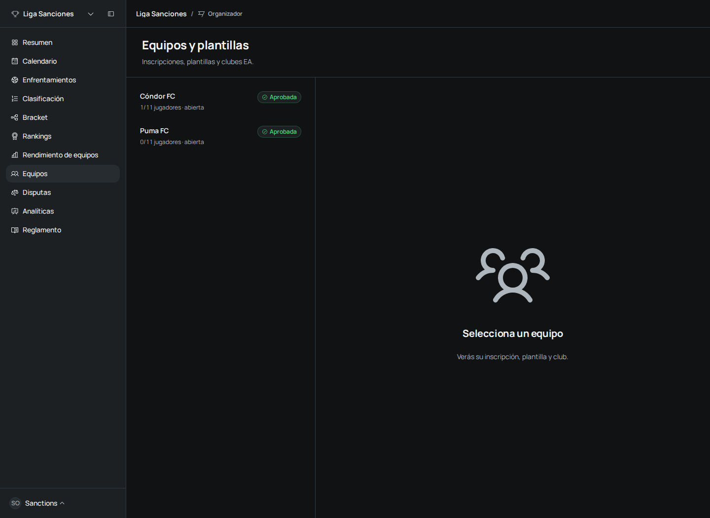
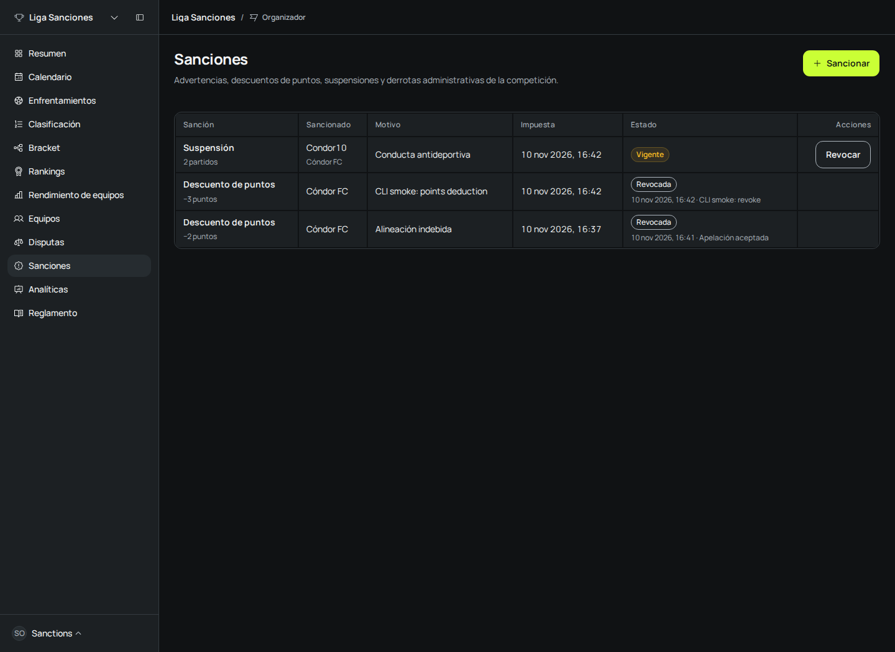
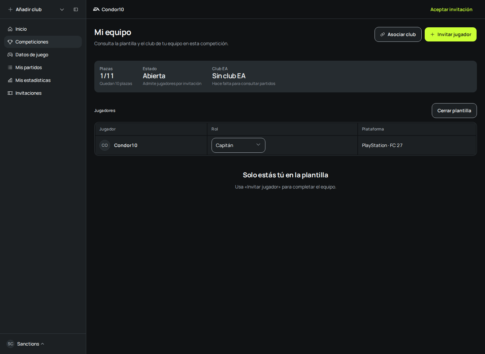
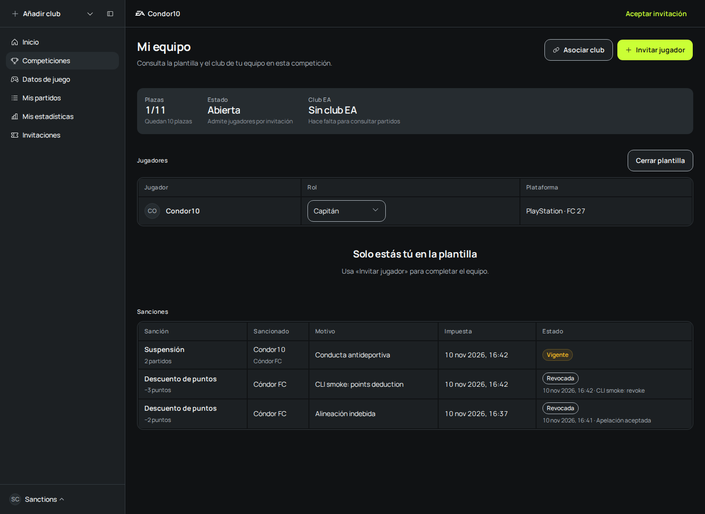
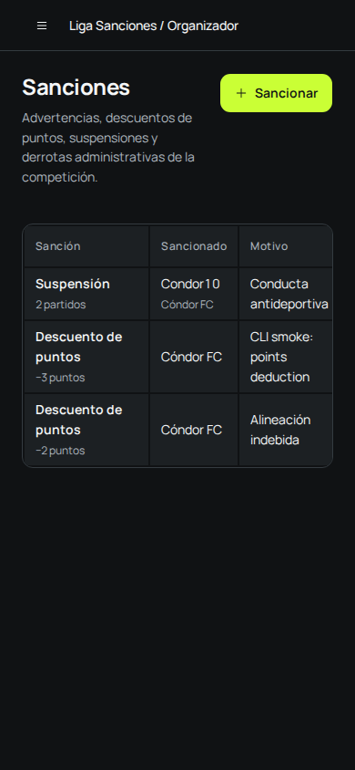

# SANC-01 verification

Verified on 2026-11-10 against an isolated local Postgres database. The original checkout's
shared database was not migrated or seeded. Before captures use `origin/main`; after captures
use the sanctions branch, with the same real auth accounts and competition.

## Behavior verified

- An organizer imposes a point deduction, sees it after reload, and revokes it with a reason.
- The affected captain reads sanctions from both organization and personal Team and roster
  destinations. No sanction controls appear there. Direct impose and revoke requests return 403.
- A player suspension is recorded through the web form. Player targets cannot receive point deductions.
- The live CLI smoke checks outsider 403s, audit fields, retained revocations, and points moving
  from 0 to -3 and back to 0. With no official matches or active deductions, the table is empty.
- PostgreSQL tests cover tenant isolation, immutable history, rollback of sanctions with their
  standings and feed writes, suspension preserving approved results, and deterministic rebuilds.
- The shell requests the sanction-read permission and exposes the correct sidebar destination.
  A read-only sanctions grant works without competition editing access.
- The 390px viewport has no page overflow. The sanctions table scrolls within its own container.

## Checks

- `npm run check` passed.
- `npm run typecheck` passed across all 25 workspaces. Affected API, web and CLI checks also passed.
- Affected API, contracts, SDK, competitions, statistics, organizations, notifications,
  shared-kernel and CLI tests passed: 223 files, 2,375 tests. One existing conditional case
  applies only to the Postgres variant and is skipped in the memory variant.
- Focused web tests cover permission loss after a cached read, form integer validation,
  feed destinations, navigation permissions, and read-only controls.
- Sanctions Storybook Chromium checks passed for 13 stories. Storybook build passed.
- Web production build and bundle budget passed. OpenAPI generation and route coverage passed.
- Live `e2e-golden-path` and `sanctions-smoke` exited 0 on the product API with Postgres.

Failing-before evidence was retained for fractional amounts, feed links, cached permission
refusals, shell permission probes, and CLI point validation. Raw command logs, action snapshots,
and readbacks live under `.agents/skills/verify-futrob/evidence/20261110T164308Z-840463/`.

## Surface checklist

| Surface        | Result                                                                                                                                          |
| -------------- | ----------------------------------------------------------------------------------------------------------------------------------------------- |
| Clients        | Web operator and affected Team views changed. Shared calls live in the SDK. Native UI is outside this task's web scope and remains unverified.  |
| Contract       | Added `/api/v1` sanctions schemas, API and BFF routes, OpenAPI artifacts, SDK methods, and route coverage.                                      |
| Access         | Organizer, organization staff, competition staff, captain, vice-captain, player, explicit deny, outsider, and cross-organization cases tested.  |
| Entry points   | Competition sidebar and direct page, feed links, four Team/roster routes, SDK, BFF and CLI smoke covered. Email waits for MAIL-01.              |
| Reverse states | Revocation retains original actor, reason, date and correlation and adds its own audit fields. A second revocation is refused.                  |
| States         | Empty, loading, error/retry, denied, ready, read-only and revoked stories covered. There are no list filters, so filtered-empty does not apply. |
| Docs           | ADR-0028 and index, architecture ownership, CLI help/README, and verification feature map updated.                                              |

Suspensions and administrative defeats are recorded decisions. They do not alter official
results. Administrative defeat scoring and email delivery remain outside this task, as recorded
in ADR-0028. No EA network behavior or native device behavior is claimed by these checks.

## Captures

| Before                                                           | After                                         |
| ---------------------------------------------------------------- | --------------------------------------------- |
|  |  |
|                    |     |

